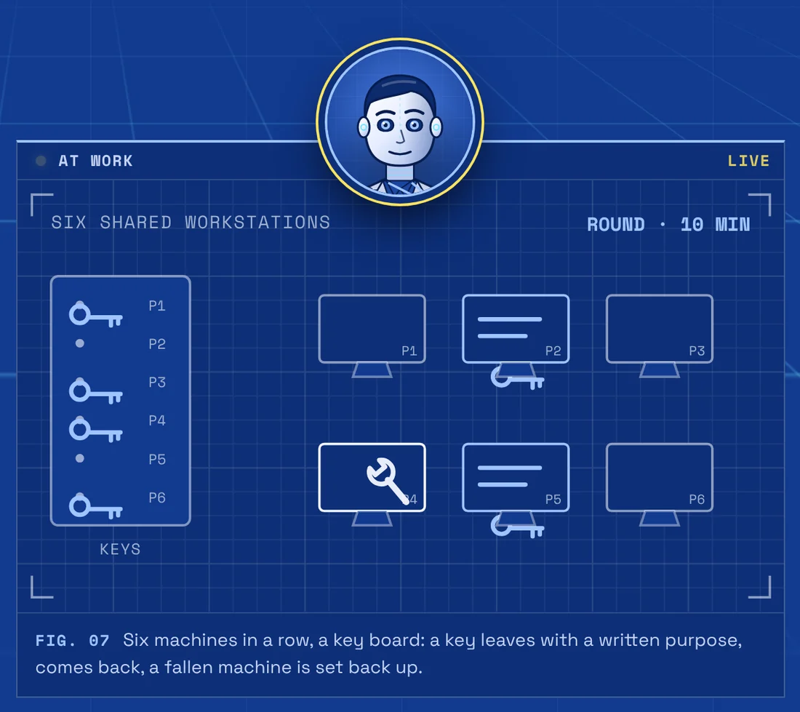
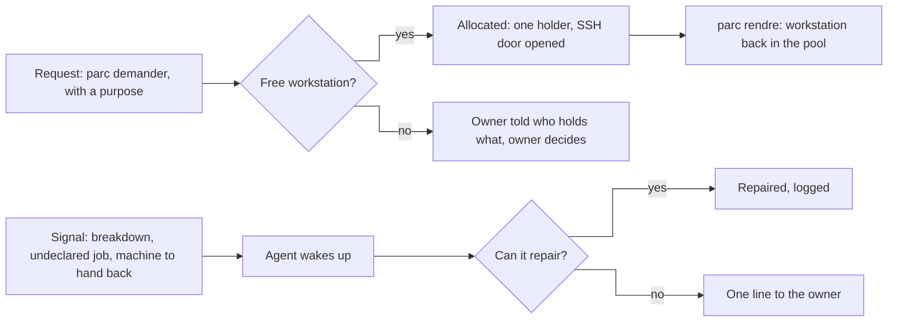
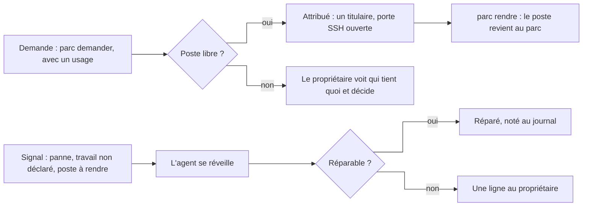

# Agent - Workstation fleet keeper

It hands out six shared compute workstations on request, takes them back when work ends and repairs what breaks.

**English** · [Français](#version-française)

> Showcase repository: the code and data of this project are private; this README describes it.

*One key per machine, and I know who has it.*

## What it does

- **Hands a workstation to whoever asks, with its purpose**: `parc demander -n 2 --besoin "what it is for"`, `parc rendre <workstation>`, `parc etat`. Each workstation has one holder and one stated purpose.
- **Refuses access without an allocation.** Without one, SSH to a workstation is refused. Colleagues reach the room only through a small gateway service with three roles (administrator, operator, user).
- **Runs its rounds and checks each machine's health**: every 10 minutes it looks for vanished holders and undeclared work, every 4 hours it checks disk, GPU, network and Unity, and every Sunday night it runs a deep check.
- **Repairs what breaks, reports the rest in one line**: the machine, the plain cause, what to do.

It never decides on its own who goes first. When there are not enough machines, it lists who holds what and the owner decides. It never takes a machine away from running work without the owner's order; the only exception is a machine whose holder has vanished and where nothing runs.

It is meant for a team that shares a few powerful machines between people and coding agents: here, six identical workstations (VR, Unity, local models).

## How it works

The agent sleeps until a signal arrives, handles it, then waits again.

| Does on its own | Brings to the owner |
|---|---|
| Allocate, take back an abandoned machine where nothing runs, repair a locked session or a network link, keep the log. | When there are not enough machines: who holds what, and the owner decides. A breakdown it cannot fix: the machine, the plain cause, what to do. |

## What it runs on

In service since 4 November 2026 on 6 workstations: allocation and SSH door, colleague gateway, rounds and health checks, repair scripts (locked session, network link, guard against unwanted shutdowns), and a page showing the state of each workstation. The code and logs are not published, so there is nothing to install from this repository.

- Claude Code agent (permanent session on a server, asleep until the next signal)
- Python (allocation, rounds, health checks)
- Go (colleague gateway)
- PowerShell (scripts deployed on the Windows workstations)
- Tailscale, OpenSSH, systemd timers

It works alongside [Agent - Session manager](https://github.com/anthohunt/agent-session-manager), which goes round the coding-agent sessions.

## Its page

- English: <https://ingevision.cloud/en/ai-agents/?p=agent-gardien-du-parc>
- Français : <https://ingevision.cloud/agents-ia/?p=agent-gardien-du-parc>

---

## Version française

# Agent - Gardien du parc

Il attribue six postes de calcul partagés à la demande, les reprend quand le travail est fini et répare ce qui casse.

> Dépôt vitrine : le code et les données de ce projet sont privés ; ce README le décrit.

*Une clé par poste, et je sais qui l'a.*

### Ce qu'il fait

- **Attribue un poste à qui le demande, avec son usage** : `parc demander -n 2 --besoin "à quoi ça sert"`, `parc rendre <poste>`, `parc etat`. Chaque poste a un seul titulaire et un usage déclaré.
- **Refuse l'accès sans attribution.** Sans attribution, l'accès SSH à un poste est refusé. Les collègues n'atteignent la salle que par une petite passerelle à trois rôles (administrateur, opérateur, utilisateur).
- **Fait sa ronde et contrôle la santé des postes** : toutes les 10 minutes, titulaires disparus et travaux non déclarés ; toutes les 4 heures, disque, carte graphique, réseau et Unity ; un contrôle approfondi chaque dimanche dans la nuit.
- **Répare ce qui casse, signale le reste en une ligne** : le poste, la cause simple, ce qu'il faut faire.

Il ne décide jamais seul qui passe en premier. S'il n'y a pas assez de postes, il dit qui tient quoi et le propriétaire décide. Il ne retire jamais un poste à un travail en cours sans son ordre ; seule exception, un poste dont le titulaire a disparu et où rien ne tourne.

Il sert à une équipe qui partage quelques machines puissantes entre des personnes et des agents de code : ici, six postes identiques (réalité virtuelle, Unity, modèles locaux).

### Comment il marche

L'agent dort jusqu'à ce qu'un signal arrive, le traite, puis attend de nouveau.

| Fait seul | Remonte au propriétaire |
|---|---|
| Attribuer, reprendre un poste abandonné où rien ne tourne, réparer une session verrouillée ou un lien réseau, tenir le journal. | Quand il manque des postes : qui tient quoi, et le propriétaire décide. Une panne qu'il ne sait pas réparer : le poste, la cause simple, ce qu'il faut faire. |

### Où il tourne

En service depuis le 4 novembre 2026 sur 6 postes : attribution et porte SSH, passerelle des collègues, rondes et contrôles de santé, scripts de réparation (session verrouillée, lien réseau, garde contre les arrêts intempestifs), et une page qui montre l'état de chaque poste. Le code et les journaux ne sont pas publiés : il n'y a rien à installer depuis ce dépôt.

- Agent Claude Code (session permanente sur un serveur, qui dort jusqu'au prochain signal)
- Python (attribution, rondes, contrôles de santé)
- Go (passerelle des collègues)
- PowerShell (scripts déployés sur les postes Windows)
- Tailscale, OpenSSH, minuteurs systemd

Il travaille avec l'[Agent - Manager des sessions](https://github.com/anthohunt/agent-session-manager), qui fait le tour des sessions d'agents de code.

### Sa fiche

- Français : <https://ingevision.cloud/agents-ia/?p=agent-gardien-du-parc>
- English: <https://ingevision.cloud/en/ai-agents/?p=agent-gardien-du-parc>

---

**Anthony Hunt** · [Agent page on ingevision.cloud](https://ingevision.cloud/en/ai-agents/?p=agent-gardien-du-parc) · [LinkedIn](https://www.linkedin.com/in/anthony-hunt-3948a9196) · [GitHub profile](https://github.com/anthohunt) · anthony@ingevision.cloud
